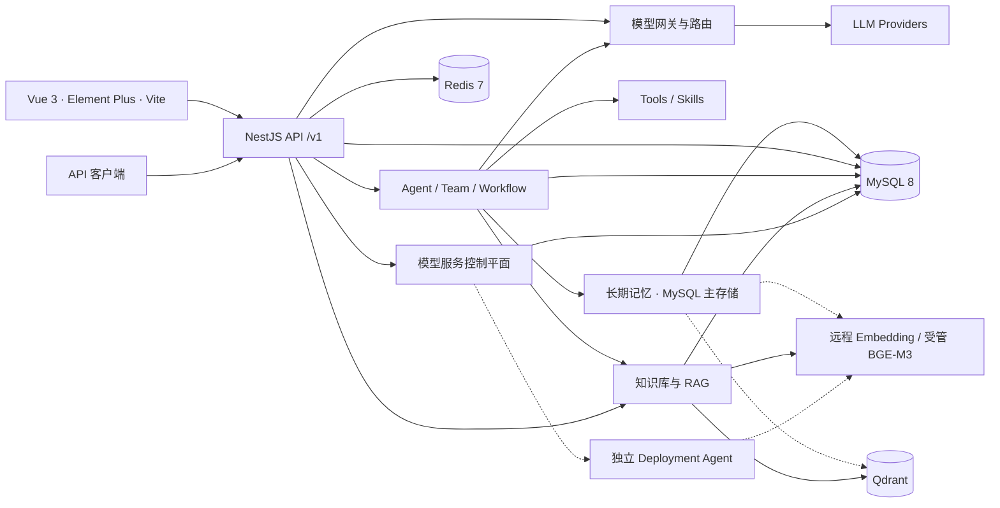

<div align="center">
  
  <h1>LLMGather</h1>
  <p><strong>Gather Models. Build Agents. Trace Every Run.</strong></p>
  <p>把多模型接入、Agent 编排与知识检索，汇聚到一个可自托管、可追踪的 AI 工作台。</p>
  <p>
    <a href="https://github.com/LDS-XiaoYe/LLMGather-personal"></a>
    
    
    
    
  </p>
  <p>
    <a href="#quick-start">快速开始</a> ·
    <a href="#features">核心功能</a> ·
    <a href="#preview">产品预览</a> ·
    <a href="#architecture">技术架构</a> ·
    <a href="#development">开发指南</a>
  </p>
</div>

---

## 不止于 AI Chat

LLMGather 面向希望统一管理模型、构建智能体并验证执行结果的开发者。你可以从多模型对话开始，将工具、知识库、记忆与 Skills 绑定到 Agent，再通过工作流组织多步任务。

与仅展示回答的聊天应用不同，LLMGather 将**执行过程**纳入工作台：查看工具输入输出、逐步回放运行轨迹、管理 Agent 版本，并用测试集和评测结果辅助迭代。

| 统一入口 | 可组合执行 | 可观察迭代 |
| :--- | :--- | :--- |
| 多 Provider、模型路由、兼容 API | Agent / Team、Workflow、RAG、Tools | Trace、历史步骤回放、版本与 Evals |

> 项目处于持续迭代阶段。下文以当前代码为准；实验能力和待验收项单独标注，不代表所有运行环境均已验证。

<a id="features"></a>

## 核心功能

### 多模型，一个入口

通过管理后台配置 Provider、模型列表与 API Key 池；统一提供 `POST /v1/chat/completions` 和 `GET /v1/models`，支持 SSE 流式输出与 `auto` 模型路由。可在同一工作台进行对话、多模型比较与协作；实际模型可用性取决于上游配置。

### 从 Agent 到协作任务

Agent 可绑定模型、提示词、工具、Skills、知识库和记忆，并保留运行历史。Agent Team 提供顺序、并行和路由策略；Agent 配置支持版本保存、发布、比较与恢复。

### 可恢复的 Workflow

现有 Vue 画布支持节点配置、连线、保存和试运行；后端接入真实 LangGraph `StateGraph`，以 MySQL 保存加密 Checkpoint、定义快照与节点执行账本，支持取消运行和从 Checkpoint 恢复。**`schemaVersion: 2`** 通过 JSON/API 启用 DAG 分支、并行与汇合；旧画布默认仍保存 v1，尚未提供完整的 v2 分支编辑体验。详见 [Workflow 架构手册](docs/P0-ARCHITECTURE.md)。

### 有真实向量的 RAG

文档解析与分块后，使用真实 Embedding 写入 **Qdrant**；原生检索支持 `keyword`、`vector`、`hybrid`，混合结果通过 RRF 融合。MySQL 保留正文与业务权限，向量空间按模型指纹隔离，支持显式重新索引和失败进度恢复；也保留可选的外部 RAGFlow 检索接入。

### 工具与上下文扩展

提供内置工具、自定义工具测试与调用、Skills 管理和 Agent 记忆管理。长期记忆以 **MySQL 为唯一主存储**，无需独立 LangGraph Memory 服务；可选启用 Qdrant 语义索引，与关键词结果通过 RRF 融合，索引故障时回退到 MySQL。详见 [记忆架构与迁移](docs/MEMORY-ARCHITECTURE.md)。代码执行工具依赖独立 Code Runner；仓库中的 MCP 管理模块目前主要实现 **Notion HTTP API 搜索与连通性测试**，并非通用 MCP 协议客户端。

### 看见运行，也验证结果

运行详情展示步骤、输入输出、状态、耗时与上下文来源；前端支持历史步骤播放和运行间对比。评测支持规则评分、配置 Judge 模型后的 LLM / Hybrid 评分，以及测试集执行；**轨迹回放不是重新执行，也不是 Checkpoint 恢复**，Judge 未配置时使用规则评分。

### 本地 BGE-M3 服务管理

管理员在「**管理后台 → 知识库模型**」注册计算节点，通过独立 Deployment Agent 下载、部署和管理模型实例，查看任务进度、日志与指标，并为知识库绑定 Embedding 服务。CPU 与 RTX 5070 的真实推理已有验收记录；Blackwell 运行时为实验项，Apple MLX 适配器仍待 Mac 真机验收。详见 [模型服务手册](docs/MODEL-SERVICES.md)。

<a id="preview"></a>

## 产品预览

当前仓库包含品牌 SVG 与模型图标，尚未收录真实产品截图或 GIF。以下为建议补充的展示内容，暂不放置空白图片或借用其他项目素材：

| 建议画面 | 展示重点 |
| :--- | :--- |
| 多模型对话工作台 | 模型选择、流式回答、多模型结果对比 |
| Agent 调试与追踪 | 工具步骤、输入输出、历史轨迹播放、评测结果 |
| Workflow 画布 | 当前节点编辑与连线，配合实际运行结果 |
| RAG 实验台 / 模型服务管理 | 检索模式、召回片段、模型绑定与部署任务进度 |

截图应来自实际运行的 LLMGather，隐藏凭证与个人数据；正式素材可统一存放到 `docs/images/`。

<a id="architecture"></a>

## 技术架构



- **前端**：Vue 3 + TypeScript + Element Plus，Vite 开发代理；构建部署使用 Nginx。
- **后端**：NestJS 11 模块化 API，JWT / API Key 鉴权，模型网关、Agent 与工作流分别组织。
- **存储**：MySQL 保存业务数据、运行轨迹、工作流 Checkpoint 与模型任务；Redis 承担缓存和安全验证等用途；Qdrant 保存原生 RAG 向量与可选长期记忆索引，两者使用独立 Collection。
- **执行基础设施**：LangGraph 在 NestJS 内嵌运行 Agent / Team / Workflow；工作流 Checkpointer 位于 `backend/src/workflows/runtime/`，不需要独立记忆服务，旧服务源码已移除。默认 Compose 自动启动独立 Deployment Agent 并登记默认 Docker CPU 部署节点，业务后端不挂载 Docker Socket；原生 GPU / Apple 节点可作为高级选项连接。

<a id="quick-start"></a>

## 快速开始

### 1. 准备环境与配置

需要 **Git、Docker 与 Docker Compose v2 或更新版本**。Windows / macOS 使用支持 Linux 容器的 Docker 环境；基本应用部署无需在宿主机安装 Node.js，也不要求本地 GPU 或 BGE-M3。

```sh
git clone https://github.com/LDS-XiaoYe/LLMGather-personal.git
cd LLMGather-personal
# 首次初始化；已有密钥会保留
docker run --rm --mount "type=bind,source=${PWD},target=/workspace" -w /workspace node:22-alpine node scripts/init-deployment.cjs
```

初始化脚本从 `.env.example` 创建根目录 **`.env`**，使用加密安全随机源生成 32 字节的 `QDRANT_API_KEY`，只保存到本地，不打印密钥。`.env` 已被 Git 忽略并从 Docker 构建上下文排除；后续初始化和启动均复用原密钥，不覆盖现有配置。若只有旧版 `.env.docker`，脚本会迁移其配置并保留已有有效密钥。

上述命令支持 Bash 与 PowerShell。Linux 使用 Docker 初始化时，可在 `docker run` 中加 `--user "$(id -u):$(id -g)"`，使生成文件归当前用户所有。宿主机已有 Node.js 22+ 时，也可直接执行 `npm run deploy:init`。编辑生成的 `.env`，补齐其他配置：

| 配置 | 用途与要求 |
| :--- | :--- |
| `MYSQL_ROOT_PASSWORD` / `MYSQL_PASSWORD` | 新数据库初始化密码与后端连接密码保持一致；容器内 `MYSQL_HOST=db`、`MYSQL_PORT=3306` |
| `JWT_SECRET` / `PLATFORM_API_KEY` | 替换为独立随机密钥；聊天 Provider 的密钥另在后台配置 |
| `CHECKPOINT_ENCRYPTION_KEY` | 至少 32 字符；跨重启保持稳定，并与数据库一起备份 |
| `MEMORY_SEMANTIC_INDEX_ENABLED` | 默认 `false`；设为 `true` 后为长期记忆建立独立 Qdrant 索引，复用 `EMBEDDING_*` 或 `MEMORY_EMBEDDING_INSTANCE_ID` 指定的受管模型 |
| `QDRANT_API_KEY` | 首次初始化自动生成并持久化；Qdrant 与 NestJS 读取同一份配置，后续复用，不需要手工重复填写 |
| `PHPMYADMIN_PORT` | 数据库管理页面端口，默认 `8080`，仅绑定宿主机 `127.0.0.1` |
| `FRONTEND_ORIGIN` | 生产默认 `http://localhost`；自定义域名或端口时同步修改 |
| `EMBEDDING_*` | 使用原生向量 / 混合检索时，填写可用端点、模型、实际维度和所需密钥；或为知识库绑定受管模型 |
| `SMTP_*` | 邮箱注册发信配置；未配置时验证码会写入后端日志，仅适合本地调试 |

**Embedding 是向量检索的前提，不是所有聊天功能的前提。** 可以调用远程 OpenAI-compatible Embedding API，也可以在管理后台 → 知识库模型中点击 **一键部署 BGE-M3（CPU）**。默认 Compose 自动准备部署节点、生成并持久化凭证、完成节点注册，不需要填写设备 ID、Token、Agent URL 或修改 `.env`。默认节点使用 Linux amd64 Docker，需满足模型内存与磁盘要求；GPU / Apple 使用自定义部署。首次点击才下载模型，默认 Compose 不会自动下载权重。详见 [模型服务手册](docs/MODEL-SERVICES.md)。

### 2. 构建并启动

使用仓库提供的构建部署配置：

```sh
docker compose --env-file .env -f docker-compose.prod.yml config --quiet
docker compose --env-file .env -f docker-compose.prod.yml up -d --build
docker compose --env-file .env -f docker-compose.prod.yml ps
```

访问 **[http://localhost](http://localhost)**。默认前端端口为 `80`（可用 `FRONTEND_PORT` 修改），Nginx 将 `/v1/` 转发到内部后端 `3000`；生产配置不直接暴露数据库、Redis、Qdrant 或后端端口。

数据库管理入口为 **[http://localhost:8080](http://localhost:8080)**。phpMyAdmin 已连接内部 `db:3306`；默认示例使用 MySQL 用户 `root`，密码为 `.env` 中的 `MYSQL_ROOT_PASSWORD`，页面不会自动登录。它与 LLMGather 的应用账号是两套独立凭证。

宿主机已有 Node.js 时，可用 **`npm run deploy`** 合并初始化与生产启动，或用 **`npm run deploy:dev`** 启动开发环境。这两个入口每次启动都会检查 `.env`，只在密钥缺失时生成；有效密钥保持不变。其他 Compose 操作可通过 `npm run deploy -- ps` 或 `npm run deploy:dev -- logs -f backend` 执行。

首次构建需要拉取镜像与安装依赖，启动后会自动建表和执行增量迁移。**空库首次成功注册的用户会成为管理员**；登录后配置聊天 Provider、模型与 API Key，再开始对话。此处没有预置管理员账号或默认密码。

**无需导入旧数据库备份。** MySQL 健康检查通过后，后端复用现有建表与迁移链，自动补齐版本化 `system_settings` Seed 并校验 23 个必需配置键；配置缓存加载成功后才启动 HTTP。Seed 来自 2026-10-12 对当前开发 MySQL 的只读提取，保留实际 TEXT、JSON 和单位格式，重复启动只补缺失项，不覆盖管理员的值、描述或更新时间。前端等待后端健康后启动。维护与排查见 [数据库初始化手册](docs/DATABASE-INITIALIZATION.md)。

### 3. 日志与维护

```sh
docker compose --env-file .env -f docker-compose.prod.yml logs -f backend frontend
docker compose --env-file .env -f docker-compose.prod.yml down
```

`down` 默认保留数据卷；不要使用 `down -v` 作为普通重启方式。修改环境变量后重新执行 `up -d`；已有 MySQL 数据卷不会因修改初始化密码变量而自动改密。

<details>
<summary><strong>开发模式 Compose：热重载、端口与注意事项</strong></summary>

根目录 `docker-compose.yml` 是**开发环境**，不是生产配置。首次使用开发环境时，初始化命令可追加 `--dev`，自动设置开发前端地址；已有 `.env` 则保留配置，需将 `FRONTEND_ORIGIN` 改为 `http://localhost:5174` 后运行：

```sh
docker compose --env-file .env config --quiet
docker compose --env-file .env up -d
docker compose --env-file .env logs -f backend frontend
```

默认地址与宿主端口：前端 **[http://localhost:5174](http://localhost:5174)**、phpMyAdmin **[http://localhost:8080](http://localhost:8080)**、后端 `3000`、MySQL `3307`、Redis `6379`。对应覆盖变量为 `FRONTEND_DEV_PORT`、`PHPMYADMIN_PORT`、`BACKEND_PORT`、`MYSQL_DEV_PORT`、`REDIS_DEV_PORT`；Qdrant 仍仅在容器网络内可达。

- 开发配置挂载源码并自动安装依赖，首次启动需等待安装完成；端口被占用时设置上述覆盖变量。
- MySQL 健康检查读取容器的 `MYSQL_ROOT_PASSWORD`，与初始化密码一致；已有数据卷改密仍需在数据库中操作。
- 开发配置包含 Code Runner，构建部署配置暂未包含；需要 JavaScript / Python 容器代码工具时须另行部署并配置 `CODE_RUNNER_URL`。
- 两种 Compose 使用不同数据卷，但应避免在同一目录同时启动，以免共享服务名与入口端口产生冲突。

</details>

<a id="development"></a>

## 开发指南

### 仓库结构

```text
LLMGather-personal/
├── frontend/          # Vue 工作台与管理界面
├── backend/           # NestJS API、Agent、Workflow、RAG 与迁移
├── deployment-agent/  # 模型下载、计算节点控制与运行时适配器
├── scripts/           # Docker 开发入口、Code Runner 等辅助脚本
├── docs/              # 架构、部署与验收手册
├── docker-compose.yml           # 开发环境
└── docker-compose.prod.yml      # 生产环境
```

### 本地开发

使用 **Node.js 22+ 与 npm**。独立准备可从宿主机访问的 MySQL、Redis 和 Qdrant；Compose 的内部地址 `db` / `qdrant` 不能直接用于宿主机进程。

```sh
npm ci
cp backend/.env.example backend/.env
cp frontend/.env.example frontend/.env
# 分别在两个终端运行
npm run dev:backend
npm run dev:frontend
```

在 `backend/.env` 配置数据库、`REDIS_URL`、`QDRANT_URL` / 密钥、Checkpoint 密钥和所需 Embedding。本地前端默认 **[http://localhost:5199](http://localhost:5199)**，后端默认 `3000`；前端通过 Vite 代理 `/v1`，后端 `FRONTEND_ORIGIN` 应设为 `http://localhost:5199`。Vite 端口以 `frontend/vite.config.ts` 为准，覆盖 `VITE_PORT` 时需在启动进程环境中设置。

长期记忆默认使用 MySQL，启动后端即可使用，不需要独立记忆服务。可选语义检索按 [记忆配置指南](docs/MEMORY-ARCHITECTURE.md) 启用；本地代码工具仍需单独运行 Code Runner。

### 检查与构建

```sh
npm --prefix backend run lint
npm --prefix backend run typecheck
npm --prefix backend test -- --runInBand
npm --prefix deployment-agent test
npm run test:deployment
npm run build:backend
npm run build:frontend
```

真实服务与硬件测试需要隔离环境及模型下载，不等同于单元测试。配置方式、迁移步骤和验收边界见 [P0 架构手册](docs/P0-ARCHITECTURE.md) 与 [模型服务手册](docs/MODEL-SERVICES.md)。

<a id="roadmap"></a>

## Roadmap 与当前边界

以下整理自现有架构与验收文档，**尚未完成，也没有承诺发布日期**：

- [ ] 补齐工作流 v2 分支的可视化编辑体验；当前通过版本化 JSON/API 配置，DAG 暂不支持环。
- [ ] 演进知识库变更索引机制：持久化 Outbox、增量更新与 Blue-green 发布；当前文档变更以串行重建为主。
- [ ] 评估中文全文 / Sparse 检索与 Reranker；当前 keyword 为词面匹配，不是完整 BM25，BGE-M3 接入当前使用 Dense Embedding。
- [ ] 完成 Apple MLX、RTX 30/40、远程 TLS、节点整机重启与开机安装器的对应环境验收。
- [ ] 补充多节点压力、任务租约故障注入和事件 / 审计保留策略。

跨 Worker 总配额调度与通用 MCP 协议接入仍需单独设计；这里不将其列为现有能力。

## 贡献与许可证

问题反馈可提交到 [GitHub Issues](https://github.com/LDS-XiaoYe/LLMGather-personal/issues)，代码或文档改进可通过 Pull Request 提交。建议附上复现步骤、相关配置（去除密钥）及检查结果；仓库目前尚无独立 `CONTRIBUTING.md`。

**许可证尚未声明**：仓库没有根目录 `LICENSE`，后端 `package.json` 标记为 `UNLICENSED`，因此这里不添加 MIT / Apache 等许可证徽章，也不将源码可见等同于已授予开源许可。

<div align="center">
  <sub>Models → Agents → Knowledge → Traces → Iteration</sub>
</div>
