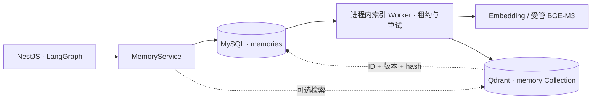

# 长期记忆：MySQL 主存储与可选语义索引

## 职责划分

LangGraph JS 在 NestJS 进程内执行 Agent、Team 与 Workflow，不需要独立 Memory Server。Workflow 使用现有 MySQL Checkpointer；Agent 当前图没有配置同等 Checkpointer，本次变更不把它描述成可恢复执行。

长期记忆的原文、用户、Agent 范围、类型、重要性与删除状态统一保存在 MySQL `memories`。Qdrant 只保存可重建的检索索引，不保存记忆正文，也不作为业务权限的依据。知识库 RAG 与记忆使用不同的 Collection。



## 配置

默认 `MEMORY_SEMANTIC_INDEX_ENABLED=false`，记忆的读写和关键词检索不调用 Embedding 或 Qdrant。Compose 仍为知识库 RAG 部署 Qdrant；关闭记忆索引不改变知识库配置。

在根 `.env`（本地开发为 `backend/.env`）设置：

```dotenv
MEMORY_SEMANTIC_INDEX_ENABLED=true
# 二选一：指定已 READY 的受管模型实例，或留空使用既有 EMBEDDING_* 配置。
MEMORY_EMBEDDING_INSTANCE_ID=
```

远程/自托管 OpenAI-compatible Embedding 使用现有 `EMBEDDING_PROVIDER_NAME/BASE_URL/API_KEY/MODEL/DIMENSIONS/REVISION`。受管 BGE-M3 则将 `MEMORY_EMBEDDING_INSTANCE_ID` 设为模型管理页面的实例 UUID，复用现有 ManagedEmbeddingService。所有后端副本应使用相同的记忆模型配置。

保存配置后通过 `npm run deploy` 或 `npm run deploy:dev` 重建/更新容器。默认每 5 秒处理一次索引任务，每批最多 20 条；首次启用和新模型指纹自动分批扫描旧记忆并排队。索引完成前查询可能回退到关键词结果，开启索引不代表所有旧数据已立即索引。

模型的指纹包含模型空间信息。Collection 为 `llmgather_memory_<fingerprint前32位>`，不会混用不同模型空间或 RAG Collection。原生记忆的关键词检索在 MySQL 中先优先选择匹配记录，再对最多 500 个候选排序，不再直接拿列表的前 100 条作为搜索全集；列表接口仍最多显示 100 条。

每条记忆记录最近成功索引的 `index_fingerprint`。切换到新模型或切回历史模型时，Worker 自动补齐与当前指纹不一致的存活记录，不会将旧 Collection 中的过期向量误认为已完成重建。

## 一致性与检索

- 新建记忆行默认 `index_pending=1`。更新、删除、批量删除在修改业务字段的同一条 SQL 中递增 `index_revision` 并设置 dirty 标记。这是记忆行内的持久 Outbox，不存在业务写入成功但尚未单独写入队列的窗口。
- Worker 使用 MySQL 条件更新抢占租约，每 30 秒续约；只有相同 owner 和 revision 才确认任务。进程中断后租约到期可重试。失去租约/版本的旧任务重新置 dirty，修复乱序写入。
- 索引失败保留任务，按有上限的退避重试。Qdrant/Embedding 故障不阻止 MySQL 记忆写入；搜索失败或没有有效语义命中时回退到关键词结果。
- 向量查询先过滤 `user_id`、Agent/全局范围、类型及模型指纹。返回 ID 后，MySQL 再检查用户、范围、类型、未删除状态、revision 和内容 hash，正文只从 MySQL 读取。旧版本或已删除向量不会成为有效记忆。
- 语义与关键词结果使用 RRF 融合，按记忆 UUID 去重。索引关闭时只使用关键词检索。
- 删除先在 MySQL 生效，然后 Worker 从所有登记的历史记忆 Collection 清除该 UUID；异步清理期间，MySQL 复核仍会排除已删除记忆。关闭 Worker 会暂停物理清理，但不会恢复已删除的业务记忆。
- Outbox 状态和 Collection 登记保存在 MySQL，应随 MySQL 备份。Qdrant 丢失索引后可从 MySQL 重建。

## API 与重建

接口保持原 `/v1/memory` CRUD 和搜索路径，使用登录 JWT。`GET /v1/memory/providers` 返回 `active: native` 与 `retrieval`（MySQL 主存储、语义开关、检索模式）；开关表示配置状态，不代表依赖健康或索引完成。

新增 `POST /v1/memory/index/rebuild`，仅为当前登录用户排队；可加 `?agentId=<UUID>` 只处理该 Agent。返回 `{ enabled, queued }`。重建异步执行；索引关闭时也可排队，之后启用再处理。重建会递增 revision，因此尚未刷新完成的旧向量会被过滤。

## 从旧独立服务迁移

1. 备份 MySQL，并保留旧 `langgraph/` 目录及旧服务数据。普通旧写入已有 MySQL 镜像，切换后原 UUID 和内容继续可读。
2. 若旧服务存在远端写入成功、MySQL 镜像失败的记录，需从旧 Store 导出并按用户与范围核对后导入 MySQL，再停旧服务。此次代码变更不会连接或自动导入远端-only 记录。
3. 更新 Compose 后，通过部署脚本启动。新配置不再创建 `langgraph-memory`，也不依赖 2024 端口。旧的 orphan 容器不会被自动删数据；核对数据后可单独停止它。
4. `MEMORY_PROVIDER=langgraph` 与 `LANGGRAPH_MEMORY_*` 不再控制当前后端。数据库中的旧 provider、external_id、provider_payload 保留，API 统一按 MySQL 原生记忆返回。
5. 如需语义检索，配置 Embedding 并开启开关，检查任务进度和实际检索；不用 embedding 也能完成 CRUD/关键词检索。

## 回滚

本次迁移只新增字段、队列索引和 Collection 登记表，不删除旧内容、旧 provider 信息或旧服务源文件。回滚应用与 Compose 时保留新增数据库字段，不执行 drop 操作；旧代码忽略这些字段。恢复独立服务前应核对切换期间新增/更新/删除的 MySQL 记忆，旧远端副本不会自动同步这些变更。代码回滚不等于远端数据自动一致。

## 验证

```sh
npm --prefix backend test -- --runInBand
node --test scripts/memory-architecture.test.cjs
npm --prefix backend run typecheck
```

`backend/src/memory/memory-index.integration.spec.ts` 为显式启用的集成测试。使用独立的 `memory_test_` 前缀 MySQL 数据库、测试 Qdrant 和可访问的真实 Embedding，设置 `MEMORY_TEST_INTEGRATION=true` 及相应 `MYSQL_*`、`QDRANT_*`、`EMBEDDING_*` 后运行该文件。普通测试会明确跳过此套集成测试，不代表已验证实际模型或数据库。

接口实现依据：[LangGraph Memory](https://docs.langchain.com/oss/javascript/concepts/memory)、[Qdrant Collections](https://qdrant.tech/documentation/manage-data/collections/)、[Qdrant Filtering](https://qdrant.tech/documentation/search/filtering/)。
